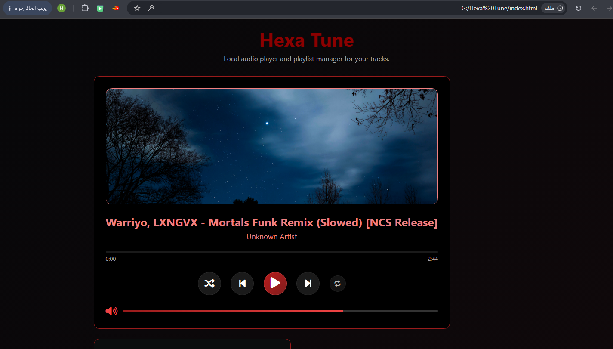
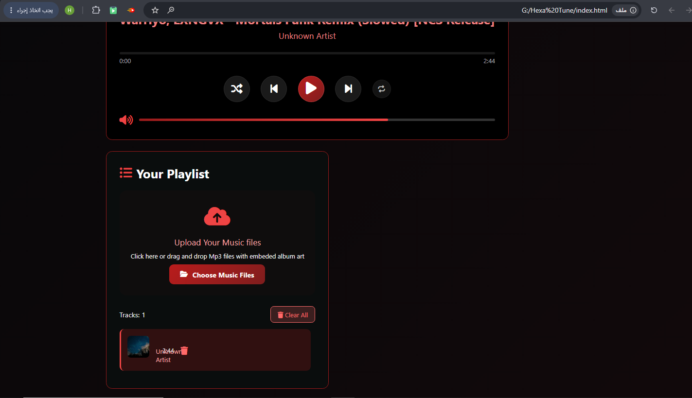

# Hexa Tune

A cool, modern web based music player built with HTML, CSS, and JavaScript.
It lets you upload, play, and organize your favourite songs in your browser.
Hexa Tune designed for music lovers who have old laptops, and want to enjoy their music without slowing down their device.

## Photos

## Features

* **Drag & drop Upload:** You can easily drag and drop your local audio files to the player
* **Auto Matadata Extraction:** The player Automatically reads track titles, artist, and album art using `jsmediatags`.
* **Keyboard Shortcuts:** Control the Playback (Play/Pause, skip, volume) with your keyboard.

* **Playback Controls:** include Shuffle mode, repeat you fav track of Hamo Elmorshedy, quick mute Button.

* **Presistant Local Storage:** Saves audio files and extraccted album art blos directly in `IndexDB` so you can play your playlist without adding the music again

## Built With
* HTML5 / CSS3 / JavaScript
* [jsmediatags](https://github.com/javascript-audio-tagging/jsmediatags) for MP3 metadata
* Browser IndexedDB Api

## AI Usage
I used AI to generate the `dataURLtoBlob` helper function, and review bugs and missing parts across the project, while building the core player logic and updating the interface to a dark charcoal and red theme myself. and also i used it to explain some commans in js because it was the first time to use it.

## Demo Link
https://hozifa503.github.io/Hexa-Tune/

## How to run

1. Clone or download this Repo.
2. open `index.html` in your browser.
3. start uploading and enjoyning your music.
